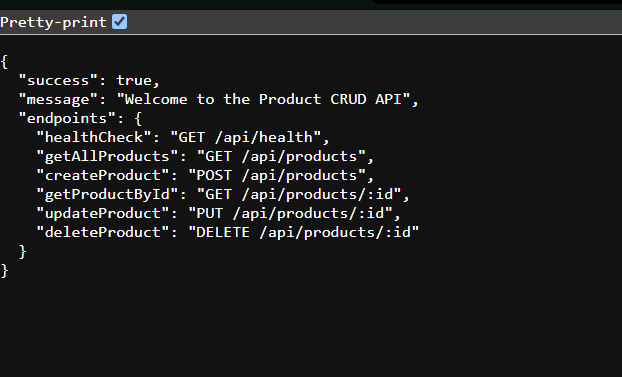
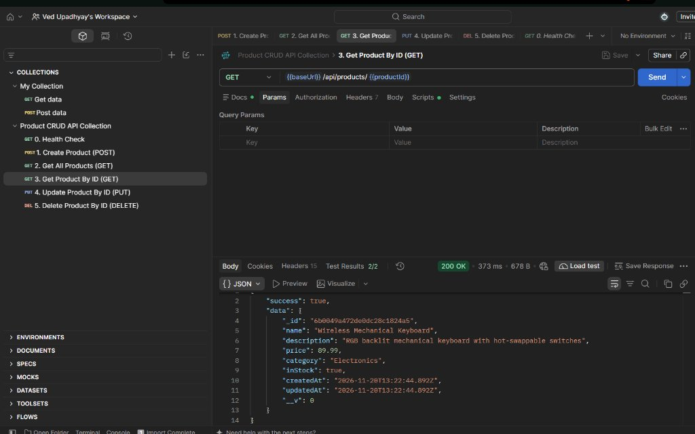

# Academic Assignment Report: CRUD API Development, Cloud Deployment & Postman Testing

---

## 👤 Student Information

| Field | Detail |
| :--- | :--- |
| **Student Name** | Ved Upadhyay |
| **PRN** | 202401040207 |
| **Class** | WT3 |
| **Branch** | Computer Engineering |
| **Assignment Title** | Assignment 6: CRUD API with Cloud Database, Deployment & Testing |
| **Live Deployed API URL** | https://product-crud-api-13j6.onrender.com |
| **GitHub Repository** | https://github.com/ved645/crud-api-assignment |

---

## 1. Problem Statement & Objectives

> **Problem Statement**:
> *"Create an API to perform CRUD operation in the database and deploy the application on any web hosting provider and test the API using Postman."*

### Key Objectives:
1. Design and develop a RESTful API implementing full CRUD (Create, Read, Update, Delete) functionality.
2. Integrate a production cloud database (MongoDB Atlas) using an Object Data Modeling (ODM) library (Mongoose).
3. Host and deploy the web service to a cloud web hosting provider (Render) with continuous deployment enabled from GitHub.
4. Verify and validate all endpoints using Postman automated test assertions and parameter chaining.

---

## 2. Technology Stack

- **Backend Framework**: Node.js with Express.js
- **Database**: MongoDB Atlas (Cloud NoSQL Database)
- **Object Data Modeling (ODM)**: Mongoose
- **Web Hosting Provider**: Render (Node Web Service)
- **Version Control & CI/CD**: Git & GitHub
- **API Testing & Verification**: Postman (v10/v11)

---

## 3. Database Schema Design

The `Product` entity model is implemented in `models/Product.js`:

```javascript
const mongoose = require('mongoose');

const productSchema = new mongoose.Schema(
  {
    name: {
      type: String,
      required: [true, 'Product name is required'],
      trim: true,
      maxlength: [120, 'Name cannot exceed 120 characters']
    },
    description: {
      type: String,
      required: [true, 'Product description is required'],
      trim: true,
      maxlength: [1000, 'Description cannot exceed 1000 characters']
    },
    price: {
      type: Number,
      required: [true, 'Product price is required'],
      min: [0, 'Price must be a positive number']
    },
    category: {
      type: String,
      required: [true, 'Product category is required'],
      trim: true
    },
    inStock: {
      type: Boolean,
      default: true
    }
  },
  {
    timestamps: true
  }
);

module.exports = mongoose.model('Product', productSchema);
```

---

## 4. REST API Endpoint Directory

Base URL: `https://product-crud-api-13j6.onrender.com`

| Operation | HTTP Method | Endpoint | Description | Status Code |
| :--- | :--- | :--- | :--- | :--- |
| **Service Info** | `GET` | `/` | API status and endpoint directory | `200 OK` |
| **Health Check** | `GET` | `/api/health` | Service uptime and timestamp | `200 OK` |
| **CREATE** | `POST` | `/api/products` | Create a new product in the database | `201 Created` |
| **READ ALL** | `GET` | `/api/products` | Retrieve all products (supports filtering & search) | `200 OK` |
| **READ ONE** | `GET` | `/api/products/:id` | Fetch specific product by MongoDB ObjectId | `200 OK` |
| **UPDATE** | `PUT` | `/api/products/:id` | Modify an existing product record | `200 OK` |
| **DELETE** | `DELETE` | `/api/products/:id` | Delete product record from database | `200 OK` |

---

## 5. Deployment Details

1. **Cloud Database (MongoDB Atlas)**:
   - Cluster Host: `cluster0.dveapgj.mongodb.net`
   - Database: `product_db`
   - Network Access: Whitelisted IP rule `0.0.0.0/0` to allow inbound connections from Render cloud instances.
2. **Web Hosting (Render)**:
   - Service Type: Web Service (Node Runtime)
   - Continuous Integration: Automated builds from GitHub `main` branch.
   - Build Command: `npm install`
   - Start Command: `npm start`
   - Environment Variables: Securely loaded `MONGODB_URI` and `NODE_ENV=production`.

---

## 6. Verification & Test Evidence

### 6.1 Live Deployed API Output in Browser
The live endpoint `https://product-crud-api-13j6.onrender.com/` returns the available endpoints directory:



### 6.2 Postman Test Execution
Testing `GET /api/products/:id` via Postman against the live Render server:
- **Status**: `200 OK`
- **Response Time**: `373 ms`
- **Test Results**: `2/2 Passed`
- **Returned Data**: Contains created product record with valid `_id` and timestamps.



---

## 7. Conclusion

The CRUD REST API was successfully designed, developed, deployed, and tested. The database connection with MongoDB Atlas allows scalable cloud persistence, Render provides 24/7 web hosting with automated GitHub deployment, and Postman confirms full test passage across all CRUD endpoints.
